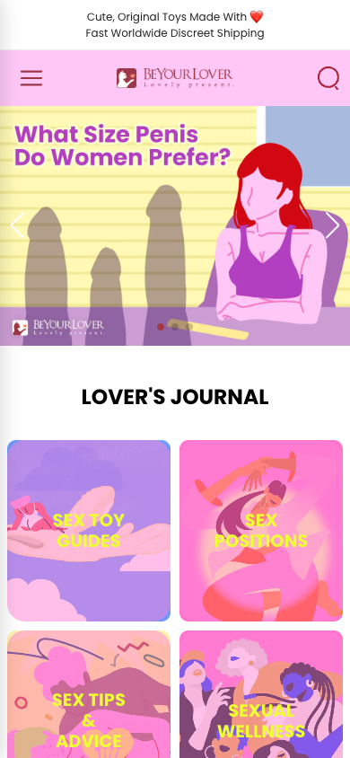
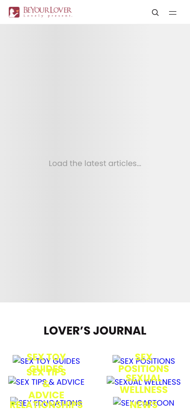
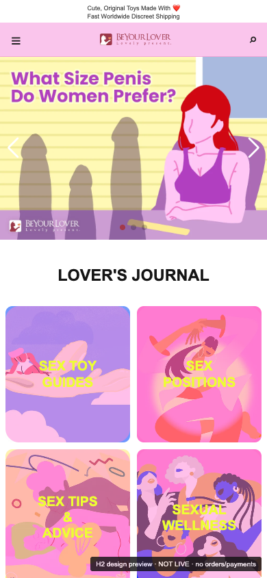
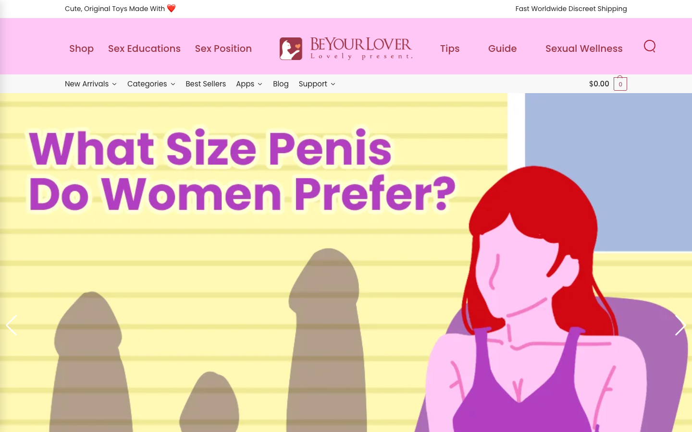
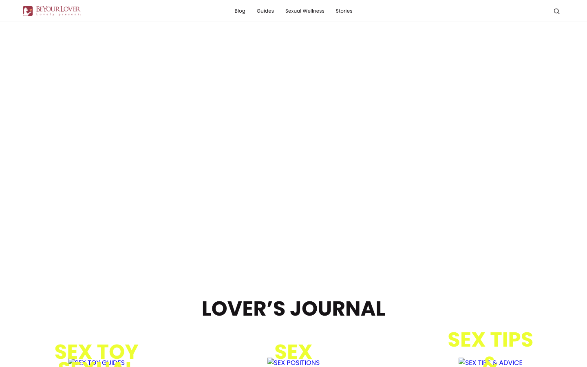
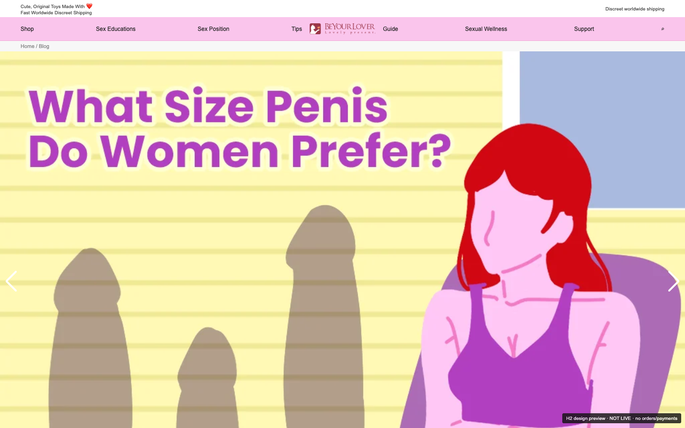

# Blog WWW Parity & Optimization V1 — B1–B4 / H2 Owner Visual Preview

**Reference captured:** 2026-10-13 PT. **GitHub code baseline:** `d8a75cb61bf5fb9371520580478ab50da0e323f1`.

**PREVIEW-ONLY, NOT LIVE CODE.** No WordPress post/page changes, plugin activation,
Theme runtime replacement, Dev or WWW deployment, PR merge, DB write, orders, payments, or email.
Do not mark Owner UAT PASS without an explicit Owner review of the visual target.

## Visual side-by-side

| Viewport | Current WWW Blog (visual authority) | Current Dev Blog (broken legacy assets) | H2 preserve-original concept |
|---|---|---|---|
| M390 |  |  |  |
| PC1440 |  |  |  |

The visual proof uses **existing public WWW Blog markup and content** sampled
at capture time, with a WWW-like announcement bar and pink navigation mock, intended to be implemented using V3 shell components. It is not
evidence that Dev article inventory and banner assets have already been migrated.
Preview source: [H2 static prototype](H2-www-blog-preserve-preview.html).

Preview browser on isolated US Mac: M390 and PC1440, **6/6 category images loaded**,
6 category modules, 5 hero Swiper slides, Swiper present, 0 horizontal overflow,
0 page errors and **0 POST requests** (GET-only interception). All screenshots
are viewport screenshots. The hero artwork is campaign content and must stay
CMS-configurable, NOT hardcoded permanently into PHP/CSS.

## Verified source facts

- WWW `/blog/`: Shoptimizer runtime, visually complete **one Blog banner,
  six colorful category icons, six category-article modules and seven Swiper
  wrappers**. Its public HTML refers to `www.beyourlover.com/css/js/swiper`
  assets and six category images on `img.beyourlover.com/2026/09/`.
- Dev `/blog/`: current standalone V3 Theme, same six category modules / seven
  Swiper wrappers **already present**, but **26** `localdev.beyourlover.com`
  mentions in rendered source; six visible category images fail to load.
- Dev WordPress **published Page ID 126** stores a Gutenberg Custom HTML block,
  with banner, categories, JS and legacy image paths. Category term slugs
  `sex-toy-guides,sex-positions,sex-tips-advice,sexual-wellness,relationships,news`
  exist; preserving old article data needs no import.
- Independent syntax bug #97 had a scoped, SHA-verified Dev code-only Canary and
  syntax test PASS. It is NOT proof the old CDN/image/blog links work.

## Approved approach proposal — do not start H3 until Owner accepts H2

### B1 — restore, not redesign
Keep WWW Blog banner dimensions, colorful category illustration, 2-column
mobile icon grid, all six category modules, item image/title, MORE links, and
semantic SEO slugs. Restore Swiper carousel behavior and fallback/loading states.

### B2 — minimal enhancements
Use V3 global header/footer, accessible tap targets, reduced layout shift,
proper lazy loading below the fold, image fallback and mobile spacing while
keeping WWW visual composition. **No creative overhaul** or random global CSS.

### B3 — technical ownership
Use existing WordPress posts/term queries; keep the image/banner/campaign
configuration data-managed. Replace stale `localdev` dependencies with correct
first-party Dev/WWW URLs or V3-versioned assets, not URL replacements hardcoded
to Dev in permanent production code. Separate Php/CSS/JS, load only on Blog,
retain Woo+Andy Commerce authority, old permalink/SEO coverage, newsletter
subsystem, and browser security controls. Build isolated tests before Dev Canary.

### B4 — Owner Final UAT
M390 and PC1440 true Dev screenshot side-by-side with current WWW.
Verify slides/links, blog categories and latest articles, missing image fallback,
no JS errors, no overflow, performance and console/network. Owner explicit
visual PASS required. No T6 WWW theme cutover on B1–B3 alone.

## Open decisions at H2

- Whether campaign artwork should match WWW at deployment time, or use CMS
  latest campaign (current WWW references time-specific October imagery).
- Whether the outer header/footer should retain V3 styling while the **Blog
  content layout itself** faithfully matches WWW. Proposed: yes.
- Existing landing Blog page has extra legacy custom footer, subscription/form
  sections; future implementation must preserve content and avoid duplicate
  global footer/newsletter actions. Do not copy a live WordPress form or old
  Shoptimizer widget into a new runtime blindly.

**No H3 coding or Dev/WWW deployment was authorized by acceptance of this
audit document alone.** Store as draft evidence and ask Owner to approve the
H2 visual direction before the H3 implementation/canary.
