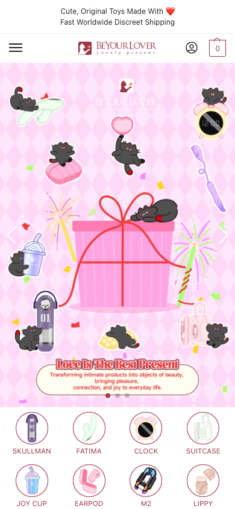
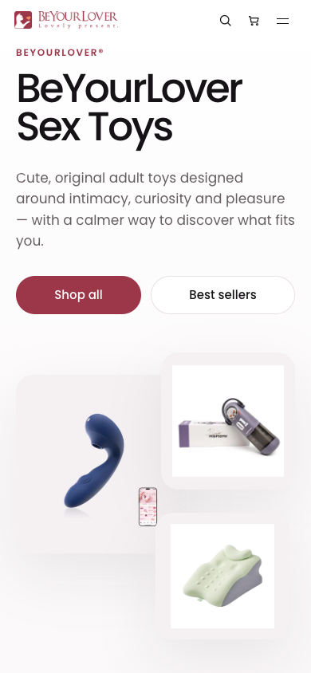
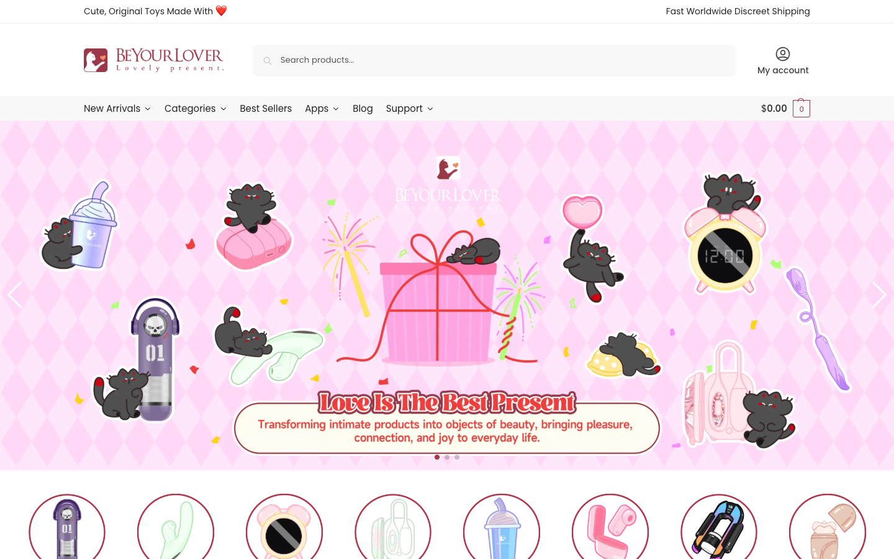
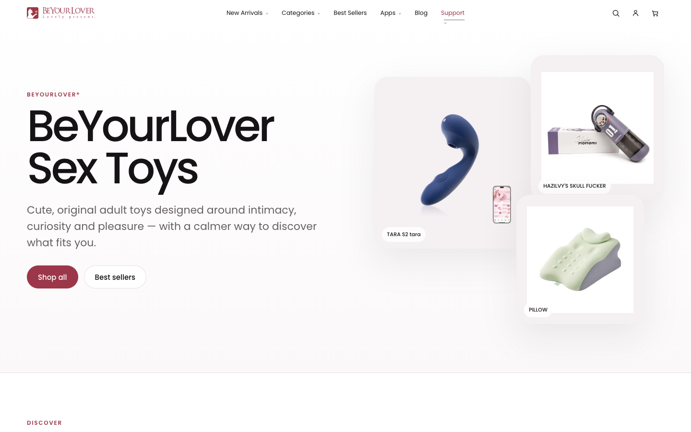

# BeYourLover Homepage — H0/H1 read-only visual evidence

Date captured: 2026-10-13 PT / 2026-10-14 UTC.
Owner workstream: [Homepage Parity Issue #76](https://github.com/beyourlovercom/beyourlover-web-v3/issues/76).
Status: **read-only H0/H1 evidence only**. NOT Owner visual PASS, NOT H2 preview acceptance,
NOT authority to write Dev/WWW, merge or replace the active Theme.

## Source screenshots — actual public site captures

| Viewport | Current WWW (Shoptimizer / child theme) | Current Dev (BYL V3) |
|---|---|---|
| M390 |  |  |
| PC1440 |  |  |

All four images are viewport screenshots, not full-page exports.
Captured using fresh isolated headless Chrome, GET/HEAD only; no Woo cart/order/payment writes.
WWW PC1440 was captured on a second read-only retry after a navigation timeout.
No sensitive logins or admin pages were visited. WWW external POSTs were blocked by
the diagnostic browser; their resulting network failures are **not** classified
as real WWW application defects.

## H1 — evidenced differences (not subjective pass/fail)

1. **Hero and promotion.** WWW has a pink illustrated promotional/campaign banner,
   central seasonal gift artwork and category circles; Dev has a white editorial
   hero, large black BeYourLover H1, two CTAs and product-photo collage.
   These are different compositions, not only CSS dimensions.
2. **Mobile header.** WWW compact white header appears below a small top slogan
   band (measured header y~56, h~48 at M390). Dev V3 header overlays the hero
   at top (y=0, h~50). Compare account/search/cart/menu tap targets explicitly.
3. **Product cards.** WWW M390 two-column Woo grid (~175px per card), category,
   badges, rating and compact price details. Dev M390 first product card spans
   ~350px, larger imagery and more vertical spacing, sale/price presentation
   reordered. WWW initial sample is at y~2103, Dev sample at y~2903, though
   campaign data/sections may shift these positions.
4. **PC1440 header/hero.** WWW header has a roughly 117px global area; Dev
   header roughly 54px and hero H1 ~92px Poppins. Section spacing and first
   shopping entry differ.
5. **Typography / theme.** WWW base text commonly uses legacy
   BeYourLover/system font around 15px; Dev V3 is predominantly Poppins
   ~16px. Keep BYL Theme OS modular and do NOT import Shoptimizer/CommerceKit.
6. **Products and campaigns** are live content, not proof of a permanent
   design spec. Preserve WooCommerce prices/stock/cart authority and Andy
   Commerce promotions; do not hard-code a transient pink seasonal banner
   as an evergreen landing design.

## H2 draft design/Owner-preview contract — do not implement yet

- **M390:** show top announcement bar, branding/menu and accessible cart,
  WWW-like campaign Hero and category visuals with fallbacks,
  two-column card comparison including product image, price, stock,
  sale and rating variants; spacing/tap target metrics; collapsed navigation.
- **PC1440:** show complete global header/nav, full hero treatment,
  campaign and product-grid placement, card width/image ratios, footer.
- **Content model:** campaign artwork, target URLs, locale and expiry must be
  content-managed; fallback hero needed for expired promotions.
- **Design mapping:** preserve WWW look/function through independent
  BYL Theme OS components, without copying the old plugins/theme runtime.
- **Safety:** no Checkout/G5 changes, order/payment/ERP edits, no production DB.
- **Approval:** Owner must review and explicitly PASS actual preview design
  before H3 implementation; separate Dev canary and UAT afterward.
  #76 existing visual FAIL stays in force.

Screenshots are evidence of the current reference at capture time, not a
perpetually fixed creative target. Reconfirm campaign/reference with Owner
before visual implementation.
